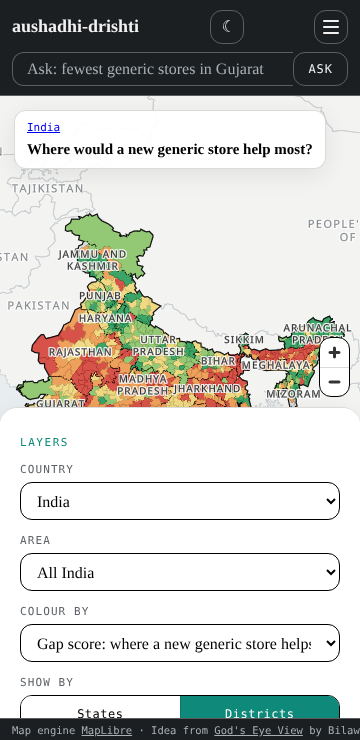
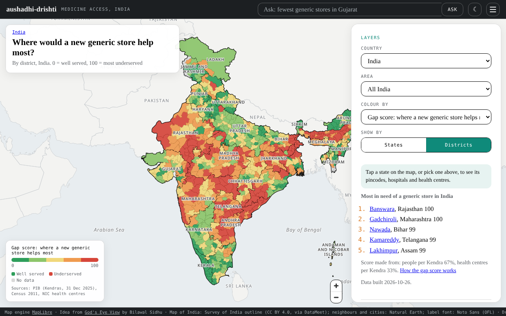
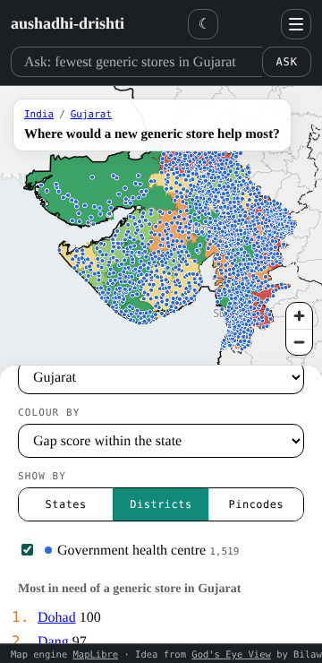
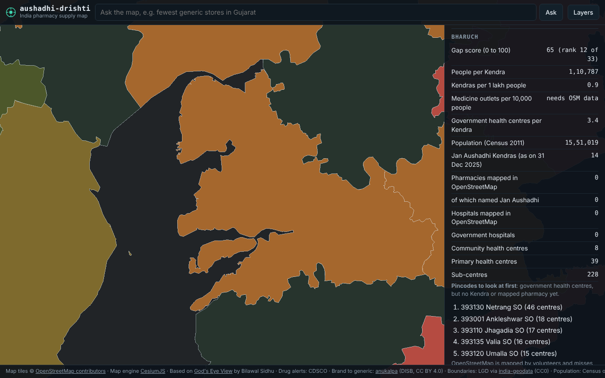

# aushadhi-drishti

An open, map-based "god's-eye view" of India's pharmacy supply side, built only from legally public data.

*aushadhi* means medicine and *drishti* means sight.

- Live map: https://falakpat3l.github.io/aushadhi-drishti/
- Covers all of India: 776 districts, 17,990 Jan Aushadhi Kendras. Bharuch (Gujarat) is the test district.
- The map of India follows the Survey of India: all of Jammu and Kashmir, Ladakh and Arunachal Pradesh are shown inside India. No street-map tiles are used, because the common free ones draw India's borders the international way.

## Credit

This project is a fork of [God's Eye View](https://github.com/bilawalsidhu/gods-eye-view) by **Bilawal Sidhu** (MIT licence). It keeps the same idea, one map that brings public signals together, and some of its look (monospace labels, a heads-up style). Since version 0.8 the map is a flat map of India drawn with MapLibre GL instead of a CesiumJS globe: lighter, sharp on phones, and pinch and trackpad friendly. The original code is kept, unchanged, in the rest of this repository. This app lives only in the `drishti/` folder. See `LICENSE` for both copyright lines.

## Rules this project follows

1. Open data only. Every source is listed in [DATA_SOURCES.md](DATA_SOURCES.md) with its licence.
2. No personal data. No names or phone numbers of people. Nothing about one pharmacist's or one business's sales, stock or shipments.
3. Areas are shown as totals by district or pincode. Public outlets (Jan Aushadhi Kendras, OpenStreetMap pharmacies, government health centres) may show as single dots, with no personal details.
4. No scraping that breaks a site's terms. No Google Maps data.
5. Free tools only. Any key lives in a `.env` file that is never committed.
6. Information only. Not for treatment decisions.

## Status

| Phase | What | State |
|---|---|---|
| 0 | Research report: [docs/PHASE0_RESEARCH.md](docs/PHASE0_RESEARCH.md) | Done |
| 1 | Fork, keep credit, centre on India, static site for GitHub Pages | Done |
| 2 | Base layers for Gujarat: districts, population, Jan Aushadhi Kendras, health centres, OSM pharmacies and hospitals, pincode totals | Done |
| 3 | Insights: people per Kendra, outlets per 10,000 people, and a gap score for where a new generic store helps most ([how it works](docs/gap-score.md)) | Done |
| 4 | Medicine layers: CDSCO quality alert counts by district and month, with links to the official lists; medicine check linking a brand (via anukalpa) to its generic, NPPA price cap and alert count | Done (see known gaps) |
| 5 | Ask the map: plain questions answered from the local data by rules; optional local AI with a key in `.env` | Done |
| 6 | Weekly refresh (GitHub Actions, Mondays) and a design for opt-in stock sharing ([design doc](docs/design-opt-in-stock-sharing.md)) | Done |
| 7 | All of India, the official map of India, OpenStreetMap data from Geofabrik, state picker | Done |
| 9 | Other countries: Singapore and New Zealand (country switch; access score from people per pharmacy and share aged 65+) | Done |

## Folder map

```
drishti/
  index.html            the page
  src/                  map code (MapLibre GL, plain JavaScript)
    theme.js            light and dark mode
    world.js            the view for other countries
    main.js             starts everything
    map.js              the map: no API keys, no street-map tiles
    ui.js               side panel and phone bottom sheet
    credits.js          attribution line, always visible
    insights.js         gap score and per-person measures
    medicine.js         alerts layer, timeline, medicine check
    ask.js, askRules.js "Ask the map" box and its rules
    layers/             one file per map layer (basemap.js draws the official map of India)
  public/               files served as they are (logo, map of India, built data)
  pipeline/             data build (Python): download, clean, place, write
    build.py            run this to make public/data/ (all of India)
    world.py            run this to make public/data/world/ (Singapore, New Zealand)
    basemap.py          run this to remake the map of India (public/basemap/)
    config.py           states, URLs, map detail
    fetch.py            polite downloads (robots.txt, one name, cache)
    geo.py              boundaries, which-district-is-this-point
    geocode.py          address to position (pincode first, then Nominatim)
    insights.py         per-person numbers and the gap score
    medicines.py        CDSCO alerts, NPPA prices, anukalpa link
    places.py           rough position for any Indian address (pincode, district, state)
    sources/            one file per data source
    seeds/              small hand-checked tables (with their sources)
  scripts/              small helper scripts for the build
  tests/                offline data tests and the headless browser check
  docs/                 how the code works, research report, gap score, stock-sharing design, known gaps,
                        permission request drafts, screenshots
  DATA_SOURCES.md       every data source, licence and fetch method
  ADDED_FILES.md        every file added or changed in this fork
  GUIDE.md              how to run it, in plain steps
```

## Screenshots

| Phone (360 px) | Laptop (1280 px) |
|---|---|
|  |  |
|  |  |

## Known gaps

See [docs/KNOWN_GAPS.md](docs/KNOWN_GAPS.md).

## Run it on your computer

See [GUIDE.md](GUIDE.md).
